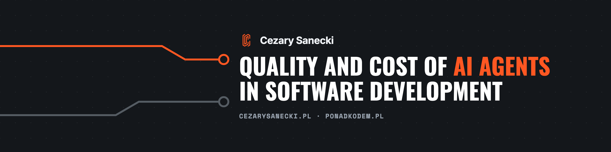

# Cezary Sanecki

I work on the quality and cost of AI agents in software development.

I'm a Software Engineer at Allegro, working in the JVM ecosystem. I show teams how to check whether code written with AI agents is good enough and how much it really costs. I run trainings and speak at conferences about architecture, refactoring and system design.

Before I became a programmer, I was a civil engineer. That's where my habit comes from: I look at code together with the business and the organization that maintains it.

## Where to find me

- [cezarysanecki.pl](https://cezarysanecki.pl/?utm_source=github_profile) 🇵🇱 PL — trainings, talks, blog
- [Ponad Kodem](https://ponadkodem.pl/?utm_source=github_profile) 🇵🇱 PL — code, architecture, business and AI for programmers
- [YouTube](https://www.youtube.com/@cezarysaneckiponadkodem) 🇵🇱 PL
- [LinkedIn](https://www.linkedin.com/in/cezary-sanecki/)

## Projects

- [Parking domain](https://github.com/cezarysanecki/parking-domain) — domain modeling of a parking lot, 100-commit contest
- [System Design in Practice](https://cezarysanecki.github.io/system-design-talk-atm-eng/) — conference talk deck
- [Refactoring playground](https://github.com/cezarysanecki/refactoring-playground) — code from my refactoring and unit testing talks and workshops, a base for refactoring practice with or without AI
- [Local Whisper](https://github.com/cezarysanecki/local-whisper) — native macOS app for offline Polish speech transcription
- [Talks slides](https://github.com/cezarysanecki/talks-slides) — slides from my conference talks

## Contact

Looking for a training or a talk on the quality and cost of AI agents? Message me on [LinkedIn](https://www.linkedin.com/in/cezary-sanecki/).
